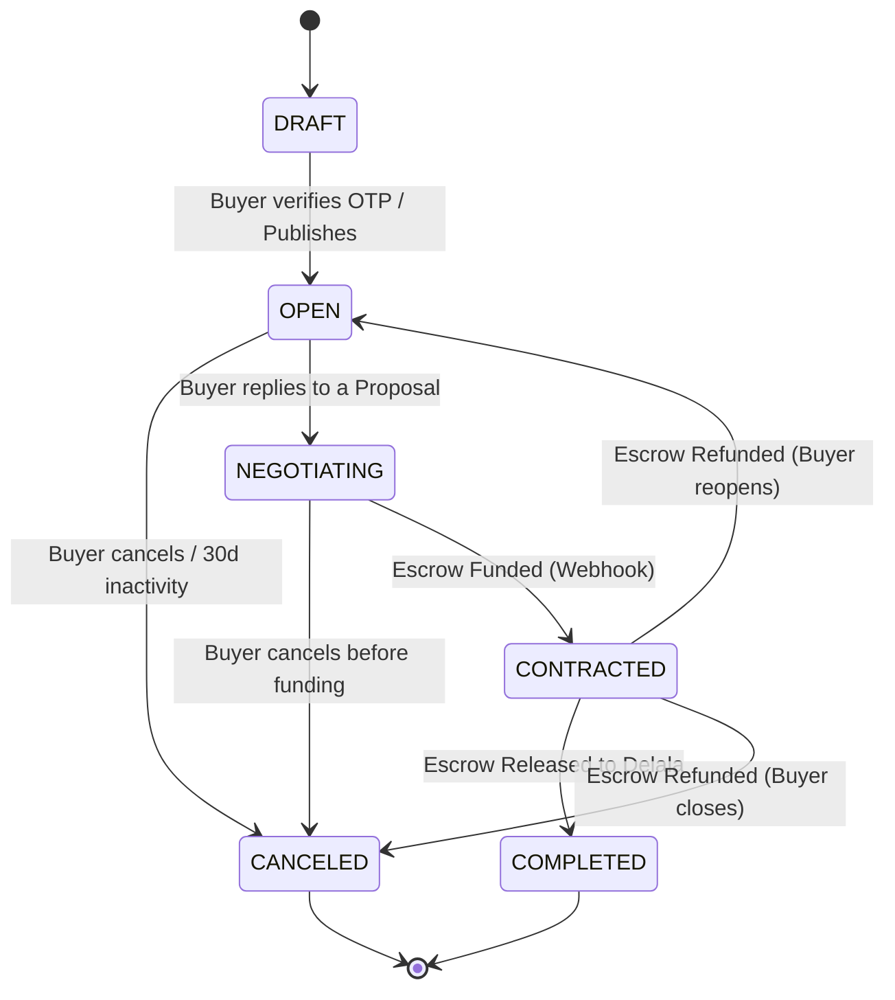
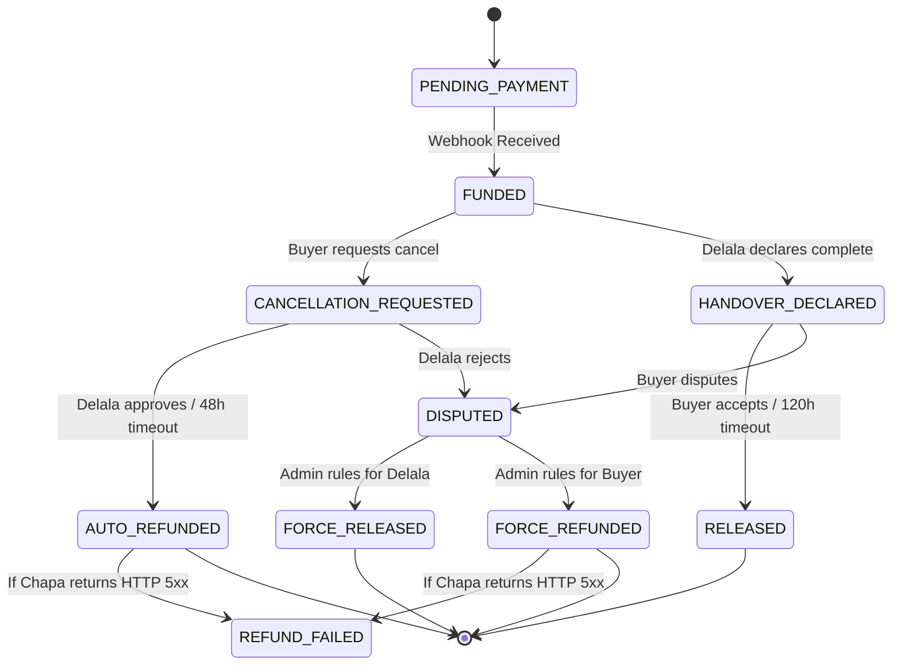

# Enterprise Software Requirements Specification (SRS)
**Project:** Delala Platform (Escrow-Backed Broker Marketplace)  
**Document Version:** 4.0 (Enterprise Production Grade)  
**Target Architecture:** PHP 8.3+ / Laravel 11+ (Modular Monolith API), PostgreSQL 16+, Redis 7+, AWS S3 (or MinIO).  
**Primary Integrations:** Chapa Payment Gateway, Primary & Secondary SMS Gateways, Firebase Cloud Messaging (FCM).  
**Target Region & Timezone:** Ethiopia (`Africa/Addis_Ababa` / EAT, stored as UTC).

---

## 1. Executive Summary & System Boundaries

### 1.1 Business Context
The Delala Platform digitizes the traditional Ethiopian informal broker ("Delala") network into a structured, escrow-backed marketplace. Buyers post requests for goods or services (real estate, vehicles, construction labor, machinery), and verified Delalas submit multi-item proposals with attached commission fees.

### 1.2 Core Financial & Operational Rules
1. **Commission-Only Escrow:** The platform processes, holds, and disburses **only the Delala's Commission (Connection Fee)**.
2. **Offline Principal Settlement:** The principal transaction (e.g., purchasing the house or car) occurs completely offline between the Buyer and the Third-Party Seller.
3. **Fee Structure:** The platform deducts a flat **5% platform fee** from the Delala's gross commission upon release. The payment gateway fee (Chapa ~2%) is absorbed by the platform out of its 5% cut.
4. **Single-Installment Escrow:** To avoid partial-funding state purgatory in V1, all escrows must be funded in a single transaction.

### 1.3 System Boundaries (In-Scope vs. Out-of-Scope)
| Domain | In-Scope (System Responsibility) | Out-of-Scope (External / Offline) |
| :--- | :--- | :--- |
| **Payments** | Collecting commission via Chapa, holding in escrow ledger, disbursing to Delala, refunding Buyer. | Collecting or verifying the principal price of the physical asset (car/house) beyond dispute receipt review. |
| **Identity** | OTP verification, Email verification, manual Admin review of uploaded Kebele ID / Passport & Selfie. | Automated biometric liveness detection or direct integration with the National ID (Fayda) API (Deferred to V2). |
| **Legal / Tax** | Generating downloadable platform fee receipts and tracking gross Delala payouts. | Filing personal income tax on behalf of independent Delalas or acting as the legal seller of record. |
| **Logistics** | Tracking digital handover declarations and mediating commission disputes. | Physical inspection, warehousing, title deed transfer, or transportation of goods. |

---

## 2. Multi-Stakeholder Perspectives

To ensure enterprise readiness, requirements are engineered across six distinct operational lenses:

*   **End Users (Buyers & Delalas):** Require low-friction onboarding (Guest OTP), real-time negotiation without latency, protection from offline scams via clear escrow rules, and reliable mobile notifications over unstable network connections.
*   **Administrators & Moderators:** Require ergonomic back-office queues (KYC, Disputes, Payouts), unified context views (chat + evidence + ledger history on one screen), and protection against internal fraud via Maker-Checker permissions.
*   **Software Developers:** Require unambiguous state machines, strict API contracts, idempotent webhook patterns, and modular domain boundaries to prevent spaghetti code.
*   **Operations / SRE:** Require health-check endpoints, dead-letter queue (DLQ) management, automated database backups with tested RTO/RPO, and zero-downtime deployment pipelines.
*   **Security & Compliance (SecOps):** Require OWASP API Top 10 mitigations, SMS toll-fraud protection, encrypted PII/KYC storage, tamper-evident audit logs, and chat anti-circumvention filters.
*   **Business Stakeholders:** Require zero revenue leakage, automated daily Chapa settlement reconciliation, and high conversion rates through trust signals (ratings, verified badges).

---

## 3. System Actors, RBAC & Governance

| Actor | Auth Mechanism | Session TTL | Core Permissions & Governance |
| :--- | :--- | :--- | :--- |
| **Guest Buyer** | Phone + 6-digit SMS OTP | 24 Hours | Create jobs, view proposals, chat, fund escrow, declare/dispute handover. Re-authenticates via new OTP mapped to existing UUID. |
| **Registered Buyer** | Phone/Email + Password | 30 Days (Sliding) | All Guest capabilities + persistent historical archive, job cloning, saved Delalas, multi-device session management. |
| **Delala (Broker)** | Phone + Email + Password + Approved KYC | 30 Days (Sliding) | Browse job feed, submit/withdraw proposals, mutate commission in chat, declare handover, request payouts. |
| **Junior Admin (Support)** | Internal SSO + Mandatory TOTP 2FA | 8 Hours (Hard) | Review/Approve KYC, view chats, moderate jobs, handle disputes <= 10,000 ETB. |
| **Senior Admin (Finance)** | Internal SSO + Mandatory TOTP 2FA + IP Allowlist | 4 Hours (Hard) | Execute payout batches, resolve high-value disputes (> 10,000 ETB), approve Maker-Checker overrides, view revenue ledgers. |

> **Enterprise Governance Rule (Maker-Checker / Four-Eyes Principle):** Any manual ledger adjustment, `FORCE_REFUND`, or `FORCE_RELEASE` exceeding **10,000 ETB** initiated by a Junior Admin enters a `PENDING_SENIOR_APPROVAL` state and requires cryptographic sign-off from a Senior Admin before execution.

---

## 4. Core Domain Models & State Machines

All stateful entities must enforce transitions at the domain layer (e.g., `spatie/laravel-model-states`) and emit domain events on every transition. Invalid transitions must throw a `422 DomainStateException`.

### 4.1 Job State Machine

#### Visual Flowchart (Mermaid)

*   `DRAFT`: Saved locally or in DB prior to OTP verification. Invisible to Delalas.
*   `OPEN`: Published to global feed. Accepting proposals.
*   `NEGOTIATING`: Buyer has initiated a chat with at least one Delala. Job remains visible in feed and continues accepting proposals from other Delalas.
*   `CONTRACTED`: Triggered atomically when an Escrow is `FUNDED`. Job is hidden from the global feed. All non-winning proposals remain `PENDING`/`NEGOTIATING` but their chat channels become temporarily read-only.
*   `COMPLETED`: Triggered when Escrow reaches `RELEASED` or `FORCE_RELEASED`. Unlocks Rating & Review module.
*   `CANCELED`: Closed by Buyer (only allowed prior to `CONTRACTED`, or after an Escrow is refunded) or terminated by Admin for policy violations.
*   *Expiration Rule:* Jobs in `OPEN` with zero activity for 30 days automatically transition to `CANCELED` (Reason: `EXPIRED`).

### 4.2 Proposal & ProposalItem State Machine
*Structure:* 1 `Proposal` has $1..N$ `ProposalItems`.
*   **Proposal States:** `PENDING` $\rightarrow$ `NEGOTIATING` $\rightarrow$ (`ACCEPTED` | `REJECTED` | `WITHDRAWN`).
*   **ProposalItem States:** `PENDING` $\rightarrow$ (`ACCEPTED_FOR_ESCROW` | `REJECTED`).
*   *Constraints:*
    1. A Delala may only have **one** active proposal per Job.
    2. A Delala can transition a proposal to `WITHDRAWN` **only** while it is in `PENDING` state. Once a Buyer replies (`NEGOTIATING`), the Delala cannot withdraw unilaterally; they must negotiate or let the Buyer reject.
    3. A Buyer can explicitly mark a Proposal or specific ProposalItem as `REJECTED` to clean up their inbox.
    4. When an Escrow for a specific `ProposalItem` transitions to `FUNDED`, that item becomes `ACCEPTED_FOR_ESCROW`, its parent Proposal becomes `ACCEPTED`, and unselected items within that same proposal become `REJECTED`. (Note: If the Buyer wishes to buy *multiple* items from the same proposal, the system generates a composite Escrow transaction locking all selected items simultaneously).

### 4.3 Escrow Transaction State Machine

*   `PENDING_PAYMENT`: Chapa checkout session initialized. Expires after 60 minutes if unpaid (`ABANDONED`).
*   `FUNDED`: Verified `payment.success` webhook received. Funds locked in ledger.
*   `CANCELLATION_REQUESTED`: Triggered **exclusively by Buyer** and **only from `FUNDED` state** (before Delala declares handover). Starts a 48-hour timer:
    *   If Delala approves cancellation $\rightarrow$ transitions to `AUTO_REFUNDED`.
    *   If Delala rejects cancellation $\rightarrow$ transitions immediately to `DISPUTED`.
    *   If Delala ignores for 48 hours $\rightarrow$ cron job transitions to `AUTO_REFUNDED`.
*   `HANDOVER_DECLARED`: Triggered by Delala once offline sale concludes. Starts a strict **120-hour (5-day) Auto-Release Timer**. Buyer can no longer request simple cancellation; they must either `ACCEPT` or `DISPUTE`.
*   `RELEASED`: Buyer clicked `ACCEPT`, or the 120-hour timer expired without dispute. Funds move to Delala's Available Wallet.
*   `DISPUTED`: Buyer rejected handover (or Delala rejected a cancellation request). Escrow is frozen. Timer is halted.
*   `FORCE_RELEASED`: Admin (with Maker-Checker if >10k ETB) ruled for Delala.
*   `FORCE_REFUNDED` / `AUTO_REFUNDED`: Admin ruled for Buyer or 48hr cancellation timer fired. Calls Chapa Refund API.
*   `REFUND_FAILED`: Chapa Refund API returned an error or failed due to insufficient merchant float. Escalates to P1 Finance Alert.

> **Concurrency Rule ("First-to-Fund Wins"):** Because a Buyer can open multiple chats in `NEGOTIATING`, they might generate two Chapa checkout links for two different Delalas and pay both at the same time. The webhook handler must acquire a pessimistic lock on the `jobs` row (`SELECT ... FOR UPDATE`). The first webhook transitions the Job to `CONTRACTED`. The second webhook detects the Job is already `CONTRACTED`, immediately records the deposit, and dispatches an automated `OVERPAYMENT_REFUND` job via Chapa, notifying the Buyer.

---

## 5. Enterprise Financial Engineering & Double-Entry Ledger

### 5.1 Chart of Accounts (CoA)
All monetary values must be stored as `BIGINT` in **Santim** (1 ETB = 100 Santim). Floating-point types (`FLOAT`, `DOUBLE`, `DECIMAL`) are strictly banned in application math; use `brick/money`. Every ledger transaction must consist of balanced journal entries where $\sum \text{Debits} = \sum \text{Credits}$.

| Account Code | Account Name | Account Type | Normal Balance | Increase Via | Decrease Via | Description |
| :--- | :--- | :--- | :--- | :--- | :--- | :--- |
| `1010` | `system_chapa_holding` | Asset | Debit | Debit | Credit | Actual cash sitting in the Chapa Merchant balance. |
| `1020` | `system_payout_clearing` | Asset | Debit | Debit | Credit | Cash in transit during bank/Telebirr payout batch processing. |
| `2010` | `buyer_escrow_liability` | Liability | Credit | Credit | Debit | Unallocated buyer deposits held in trust. |
| `2020` | `delala_pending_wallet` | Liability | Credit | Credit | Debit | Per-Delala sub-ledger for locked escrow commissions (95%). |
| `2030` | `delala_available_wallet`| Liability | Credit | Credit | Debit | Per-Delala sub-ledger for cleared, withdrawable funds. |
| `4010` | `platform_revenue_wallet`| Equity / Revenue| Credit | Credit | Debit | Platform's earned 5% commission fee. |
| `5010` | `chapa_gateway_expense` | Expense | Debit | Debit | Credit | Tracks the ~2% Chapa processing fee absorbed by the platform. |

### 5.2 Double-Entry Journal Specifications
*Example Scenario: Buyer funds a **10,000.00 ETB** commission. Chapa takes a 2% fee (200.00 ETB), settling 9,800.00 ETB net, while Platform charges Delala 5% (500.00 ETB).*

| Event ID | Business Trigger | Account Name | Dr / Cr | Amount (ETB) | Notes |
| :--- | :--- | :--- | :--- | :--- | :--- |
| **JNL-1A** | Chapa Webhook Received | `system_chapa_holding` | **Debit** | 9,800.00 | Net cash settled into Chapa merchant account. |
| | | `chapa_gateway_expense` | **Debit** | 200.00 | 2% Chapa fee recorded as platform expense. |
| | | `buyer_escrow_liability` | **Credit** | 10,000.00 | Full 10,000 ETB credited to buyer's escrow liability. |
| **JNL-1B** | Provisional Split (Atomic with 1A) | `buyer_escrow_liability` | **Debit** | 10,000.00 | Zeroes out temporary buyer liability. |
| | | `delala_pending_wallet` | **Credit** | 9,500.00 | 95% allocated to Delala's locked escrow balance. |
| | | `platform_revenue_wallet` | **Credit** | 500.00 | 5% gross fee (Net revenue is 500 - 200 = 300 ETB). |
| **JNL-2** | Escrow `RELEASED` or `FORCE_RELEASED` | `delala_pending_wallet` | **Debit** | 9,500.00 | Unlocks funds from pending. |
| | | `delala_available_wallet` | **Credit** | 9,500.00 | Funds now eligible for Delala withdrawal. |
| **JNL-3** | `FORCE_REFUNDED` or `AUTO_REFUNDED` | `delala_pending_wallet` | **Debit** | 9,500.00 | Reverses Delala provisional allocation. |
| | | `platform_revenue_wallet` | **Debit** | 500.00 | Reverses platform revenue. |
| | | `system_chapa_holding` | **Credit** | 10,000.00 | Full 10,000 ETB returned to Buyer (200 ETB expense remains in `5010` as loss). |
| **JNL-4A** | Delala Requests Withdrawal | `delala_available_wallet` | **Debit** | 9,500.00 | Immediately deducts from available to prevent double-withdrawal. |
| | | `system_payout_clearing` | **Credit** | 9,500.00 | Held in clearing while Admin processes bank CSV. |
| **JNL-4B** | Admin Marks Payout `PAID` | `system_payout_clearing` | **Debit** | 9,500.00 | Clears in-transit liability. |
| | | `system_chapa_holding` | **Credit** | 9,500.00 | Cash leaves merchant bank account. |

### 5.3 Automated Daily Reconciliation Engine
*   **FIN-1.1 Nightly Reconciliation Job:** Every night at `02:00 EAT`, a scheduled job must query the Chapa Transactions/Settlements API for the previous 24 hours and compare every remote transaction against local `EscrowTransaction` records and `1010 system_chapa_holding` journal entries.
*   **FIN-1.2 Discrepancy Circuit Breaker:** If any discrepancy is detected (e.g., a Chapa transaction marked paid remotely but missing locally, or a ledger imbalance where $\sum \text{Dr} \neq \sum \text{Cr}$), the system must immediately fire a P1 Critical Alert to Finance/Engineering and temporarily freeze automated wallet withdrawals for the affected account.

---

## 6. Functional Requirements (FR)
*(Prioritization Key: **[M]** = Mandatory for V1 Launch | **[O]** = Optional / Deferred to V1.1+)*

### 6.1 Identity, Guest Sessions & JIT Account Migration
*   **FR-1.1 Passwordless Guest Auth [M]:** The system shall allow a Guest Buyer to initiate a session by providing `full_name` and `phone_number` (validated as Ethiopian E.164 format `+2519...` or `+2517...`). Upon validating a 6-digit SMS OTP, the API returns a Sanctum token scoped to `role:guest` with a 24-hour TTL.
*   **FR-1.2 Guest Session Recovery [M]:** If a Guest's token expires or they switch devices, submitting the same `phone_number` and verifying a new OTP must issue a new token bound to their existing `user_id`, restoring full access to their active jobs, chats, and escrows.
*   **FR-1.3 Direct Registration [M]:** Users may register directly with `full_name`, `phone_number`, `email`, and `password`. The account remains `UNVERIFIED` until both the 6-digit SMS OTP (10-min TTL) and signed Email Verification Link (60-min TTL) are completed.
*   **FR-1.4 Just-In-Time (JIT) Guest Migration [M]:** A logged-in Guest Buyer may upgrade to a Registered Buyer by submitting `email` and `password`. The backend must update the *existing* `users` row in-place, upgrade the role to `role:buyer`, issue a new 30-day token, and dispatch an email verification link. No foreign keys (`job.buyer_id`, `escrow.buyer_id`) may be altered or orphaned.
*   **FR-1.5 Migration Collision Handling [M]:** If a Guest submits an `email` during upgrade that already exists in the `users` table, the API must abort and return `409 Conflict` with error code `EMAIL_ALREADY_REGISTERED`.
*   **FR-1.6 Unverified Account Purge [M]:** Direct registrations remaining `UNVERIFIED` after 72 hours with zero associated jobs must be hard-deleted via a daily cron job to release locked phone/email constraints.

### 6.2 Delala Onboarding, KYC & Payout Profiles
*   **FR-2.1 KYC State Machine [M]:** Delala accounts transition through: `PENDING_SUBMISSION` $\rightarrow$ `UNDER_REVIEW` $\rightarrow$ (`APPROVED` | `REJECTED`).
*   **FR-2.2 Access Gate [M]:** Middleware (`EnsureDelalaIsApproved`) must block any Delala not in the `APPROVED` state from calling Job Feed, Proposal, or Chat endpoints (`403 Forbidden`).
*   **FR-2.3 KYC Artifact Requirements [M]:** Delalas must upload: (1) Front/Back of Kebele ID, National Fayda ID, or Valid Passport, and (2) A clear live selfie.
*   **FR-2.4 Payout Destination Registration [M]:** Before requesting a withdrawal, an `APPROVED` Delala must register at least one payout method (`CBE`, `Bank of Abyssinia`, `Awash Bank`, `Telebirr`, etc.) with `account_holder_name` and `account_number`. The `account_holder_name` must fuzzy-match their verified KYC name (verified by Admin on first payout).
*   **FR-2.5 Withdrawal Constraints [M]:** Minimum withdrawal is **500.00 ETB**. Maximum 1 pending withdrawal request at a time per Delala. Withdrawal SLA is 24–48 business hours.

### 6.3 Dynamic Job Taxonomy & Discovery Feed
*   **FR-3.1 Hierarchical Category & JSON Schema [M]:** Admins manage a 2-level category tree (e.g., `Vehicles -> Passenger Cars`, `Real Estate -> Residential Rental`). Each leaf category stores a strict **JSON Schema (Draft-07)** definition.
*   **FR-3.2 Write-Time Schema Validation [M]:** When a Buyer posts a Job, the API validates standard columns (`title`, `description`, `category_id`, `location_region`, `location_subcity`, `budget_min`, `budget_max`) AND validates the `attributes` JSONB payload against the category's JSON Schema. Invalid payloads return `422 Unprocessable Entity`.
*   **FR-3.3 Delala Feed Query & Cursor Pagination [M]:** The feed exposes `OPEN` and `NEGOTIATING` jobs. It supports filtering by `category_id`, `location_region`, and `budget_min/max`, sorted by `created_at DESC`. It **must** use cursor-based pagination (`?cursor=...`) to prevent duplicate/skipped rows during high-velocity posting.
*   **FR-3.4 Feed Visibility Rules [M]:** Jobs where the authenticated Delala has already submitted a proposal are excluded from their general discovery feed and moved to their "My Submitted Proposals" tab. Each job card exposes a public `proposals_count` integer.

### 6.4 Multi-Item Proposals & Negotiation Chat
*   **FR-4.1 Multi-Item Proposal Submission [M]:** Against an `OPEN` or `NEGOTIATING` job, a Delala can submit a Proposal containing $1..10$ `ProposalItems`. Each item requires: `item_name`, `description`, `text_location`, `estimated_item_price` (informational ETB), `commission_amount` (integer Santim), and $0..5$ S3 image keys.
*   **FR-4.2 Commission Floor Validation [M]:** While the frontend provides a calculator toggle (allowing the Delala to calculate between 5% and 100% of `estimated_item_price` or enter a flat amount), the backend validates that `commission_amount >= 10000` (minimum 100.00 ETB) and stores only the fixed integer Santim value.
*   **FR-4.3 Chat Instantiation Gate [M]:** A `ChatChannel` is created **only** when a Buyer sends the first message on a specific Proposal or clicks "Negotiate". Delalas cannot message Buyers first.
*   **FR-4.4 In-Chat Commission Mutation [M]:** Inside an active chat, the Delala can update the `commission_amount` of any `PENDING` item in their proposal. Every change writes a record to `proposal_item_price_histories` (`old_amount`, `new_amount`, `changed_by`, `created_at`) and broadcasts a real-time `CommissionUpdated` system event into the chat stream.
*   **FR-4.5 Anti-Circumvention Engine (PII & Contact Filtering) [M]:** Because users will attempt to exchange phone numbers in chat to bypass the 5% platform fee, all chat messages sent *prior* to the Job reaching `CONTRACTED` state must pass through a synchronous Regex/Normalization filter:
    *   Blocks Ethiopian phone patterns (`09...`, `07...`, `+251...`), spelled-out numbers (`zero nine...`), Telegram handles (`@username`, `t.me/`), and email addresses.
    *   Blocked messages are rejected with `422` ("Sharing contact details before funding escrow violates platform rules") and increment a `circumvention_strike_count` on the user profile. 3 strikes trigger an Admin Moderation flag.
    *   *Post-Escrow Unlock:* Once Escrow is `FUNDED` (`CONTRACTED` state), the filter is disabled for that channel and both parties' verified phone numbers are automatically revealed in the chat header so they can meet offline.

### 6.5 Handover, Dispute Resolution & Evidence Rules
*   **FR-5.1 Handover Declaration [M]:** After the offline transaction occurs, the Delala clicks `Declare Handover Complete`, transitioning the Escrow to `HANDOVER_DECLARED` and starting the 120-hour countdown.
*   **FR-5.2 Dispute Initiation [M]:** Anytime during `HANDOVER_DECLARED` (before 120 hours expire), the Buyer can click `Dispute Handover`, selecting a reason code (`ITEM_NOT_AS_DESCRIBED`, `SELLER_NO_SHOW`, `DEAL_FELL_THROUGH`) and providing a text explanation.
*   **FR-5.3 Third-Party Seller Evidence Rule [M]:** When an Escrow enters `DISPUTED`, the Delala has 48 hours to upload Dispute Evidence (1–5 files: PDF/JPEG/PNG). The UI and API documentation must explicitly enforce the domain rule: **Because the principal payment goes from Buyer to Seller, valid proof must demonstrate a transfer where Sender = Buyer Name/Account and Receiver = Third-Party Seller Name/Account (or a signed physical bill of sale/contract between Buyer and Seller).**

### 6.6 Trust Signals, Ratings & Profiles
*   **FR-6.1 Mutual Rating System [O - V1.1]:** Once a Job reaches `COMPLETED`, both Buyer and Delala have 14 days to submit a 1–5 star rating and review text. Reviews are revealed using a **double-blind mechanism** (hidden until both submit, or after 14 days elapse) to prevent retaliatory ratings.
*   **FR-6.2 Delala Public Trust Profile [M]:** Buyers viewing a proposal can inspect the Delala's public profile containing: Display Name, Verified KYC Badge, Member Since Date, Total Completed Deals count, Average Star Rating, and Primary Categories.

---

## 7. Back-Office & Administrative Requirements

The Admin Portal must be isolated from public routes, protected by IP rate-limiting and mandatory TOTP 2FA.

*   **AR-1 KYC Verification Queue [M]:** Paginated FIFO queue of `UNDER_REVIEW` Delalas. Displays user metadata alongside 15-minute pre-signed S3 URLs for ID and Selfie. Admin selects `APPROVE` or `REJECT` (selecting from standardized rejection reasons + custom note).
*   **AR-2 Dispute Mediation Console [M]:** Displays a unified split-screen view for `DISPUTED` escrows:
    *   *Left Pane:* Job details, Proposal Item details, price mutation history, and full chronological chat transcript (including any blocked circumvention attempts).
    *   *Right Pane:* Buyer's dispute claim and Delala's uploaded evidence (Buyer-to-Seller transfer slips).
    *   *Actions:* `FORCE_RELEASE` or `FORCE_REFUND` (requiring mandatory Admin justification note logged to the immutable audit trail, and Senior Admin approval if > 10,000 ETB).
*   **AR-3 Payout Batch Operations [M]:** Allows Senior Admins to filter `PENDING` withdrawal requests by bank/Telebirr, lock them into a `PROCESSING_BATCH`, export a bank-compatible CSV file, and upload the bank confirmation reference to mark items `PAID` (triggering Journal `JNL-4B`).
*   **AR-4 User Suspension & Kill-Switch [M]:** Admins can `SUSPEND` any user:
    *   Revokes all active Sanctum tokens immediately.
    *   Drops active Reverb WebSocket connections.
    *   Sets all `PENDING` proposals of a suspended Delala to `WITHDRAWN`.
    *   *Constraint:* Active `FUNDED` escrows are **not** auto-canceled upon suspension; they are automatically flagged for manual Admin review so funds are not stranded.
*   **AR-5 Financial & Reconciliation Dashboard [M]:** Real-time readouts of Chart of Accounts balances (`1010` through `5010`), daily net revenue, and nightly Chapa reconciliation status reports.

---

## 8. Event-Driven Notification Matrix

All notifications are dispatched asynchronously via Redis Queues (`notifications` queue) using idempotent notification IDs.

| Domain Event | Recipient | SMS | Push (FCM) | Email | In-App | Critical Timing / Notes |
| :--- | :--- | :---: | :---: | :---: | :---: | :--- |
| `KycApproved` / `KycRejected` | Delala | Yes | Yes | Yes | Yes | Immediate. Includes rejection reason if applicable. |
| `ProposalSubmitted` | Buyer | No* | Yes | No | Yes | *If Buyer is a Guest with no app installed, send SMS ( throttled to max 1 SMS per 3 hours for new proposals). |
| `ChatMessageSent` | Counterparty | No | Yes | No | Yes | Suppressed if user is currently connected to the active WebSocket channel. |
| `CommissionAmountUpdated` | Buyer | No | Yes | No | Yes | High-priority push notification. |
| `EscrowFunded` | Delala & Buyer| Yes | Yes | Yes | Yes | Reveals phone numbers to both parties. |
| `CancellationRequested` | Delala | Yes | Yes | No | Yes | Warns Delala of 48-hour auto-refund deadline. |
| `HandoverDeclared` | Buyer | Yes | Yes | Yes | Yes | Warns Buyer of 120-hour auto-release timer. |
| `HandoverTimerWarning (96h)`| Buyer | Yes | Yes | No | Yes | Fired exactly 24 hours before auto-release executes. |
| `DisputeOpened` | Delala & Admin| Yes | Yes | Yes | Yes | Prompts Delala to upload Buyer-to-Seller transfer proof within 48h. |
| `EscrowReleased` / `Resolved` | Delala & Buyer| Yes | Yes | Yes | Yes | Confirms final payout or refund status. |

---

## 9. External Integrations, Circuit Breakers & Failure Modes

### 9.1 Media Upload Architecture (S3 Pre-Signed Pipeline)
To prevent PHP worker exhaustion, file binary payloads must **never** pass through the Laravel application server:
1. Client requests upload slot: `POST /api/v1/media/presign` with `file_type` (`kyc_id`, `proposal_image`, `dispute_evidence`), `mime_type`, and `file_size_bytes`.
2. Backend validates constraints (Images: `image/jpeg`, `image/png`, `image/webp` $\le 5\text{MB}$; Docs: `application/pdf` $\le 5\text{MB}$) and returns a 10-minute AWS S3 Pre-Signed `PUT` URL with strict `Content-Length` and `Content-Type` conditions.
3. Client uploads directly to S3 and passes the resulting `s3_key` when submitting the Proposal, KYC, or Dispute form.
4. Backend verifies the object exists in S3 (`Storage::disk('s3')->exists($key)`) inside the form validation request before saving the DB record.

### 9.2 Failure & Resilience Matrix
| External System | Failure Mode | Circuit Breaker & Mitigation Strategy |
| :--- | :--- | :--- |
| **Chapa Checkout API** | HTTP 5xx or timeout (> 5s) when Buyer clicks "Accept & Pay". | Abort database transaction; do **not** create an orphaned `EscrowTransaction`. Return `503 Payment Gateway Unavailable` with retry prompt. |
| **Chapa Webhook Delivery** | Platform maintenance or network partition drops incoming webhook. | Rely on Chapa's native retry backoff AND run a background **Active Polling Fallback Job** every 15 minutes that calls Chapa's `GET /transaction/verify/{tx_ref}` for any `PENDING_PAYMENT` record older than 10 minutes. |
| **Chapa Refund API** | Refund call fails during `FORCE_REFUND` or `AUTO_REFUND`. | Transition Escrow to `REFUND_FAILED`. Do **not** execute ledger reversal `JNL-3` until refund succeeds. Queue 3 exponential backoff retries; if still failing, page Senior Admin. |
| **Primary SMS Gateway** | Delivery failure or HTTP error during OTP dispatch. | Implement a **Sliding Window Circuit Breaker** in Redis: if failure rate exceeds 15% over a 5-minute rolling window (min 10 requests), automatically trip breaker and route OTP traffic to Secondary Ethiopian SMS Provider for 30 minutes. |

---

## 10. Enterprise Non-Functional Requirements (NFR)

### 10.1 Security, Privacy & OWASP API Compliance
*   **NFR-SEC-1 (SMS Toll Fraud & Rate Limiting):** `/api/v1/auth/send-otp` must enforce a 60-second cooldown between requests, max 3 requests/hour per `phone_number`, max 10 requests/hour per IP, and validate a Cloudflare Turnstile / reCAPTCHA v3 token.
*   **NFR-SEC-2 (Authentication Hardening):** Passwords must be hashed using `Argon2id` (memory: 64MB, time: 4, threads: 2). Failed login attempts lock the account for 15 minutes after 5 consecutive failures.
*   **NFR-SEC-3 (BOLA / IDOR Prevention):** Every API endpoint accessing a resource (`Job`, `Proposal`, `ChatChannel`, `EscrowTransaction`) must authorize access via explicit Laravel Policies verifying ownership (`$user->id === $job->buyer_id`). Sequential auto-incrementing IDs must **not** be exposed in public URLs; use **UUIDv7** (time-sortable UUIDs) for all public resource identifiers.
*   **NFR-SEC-4 (Cryptographic Webhook Validation):** Chapa webhooks must verify the `x-chapa-signature` or `chapa-signature` header using `hash_hmac('sha256', $rawPayload, $secret)` evaluated via timing-attack-safe `hash_equals()`.
*   **NFR-SEC-5 (Encryption & PII Protection):** All traffic must use TLS 1.2/1.3. S3 buckets storing KYC and Dispute documents must enforce Server-Side Encryption (SSE-S3/KMS), block all public ACLs, and serve files exclusively via 15-minute pre-signed GET URLs. Application logs must automatically redact `password`, `otp`, `token`, and full bank account numbers.

### 10.2 Auditing & Non-Repudiation
*   **NFR-AUD-1 (Immutable Audit Trail):** All state mutations on `EscrowTransaction`, `User` (KYC/Role/Suspension), `ProposalItem` (commission changes), and `PayoutRequest` must write to an append-only `audit_logs` table capturing: `actor_id`, `actor_role`, `ip_address`, `user_agent`, `auditable_type`, `auditable_id`, `old_values` (JSONB), `new_values` (JSONB), and `created_at`. The database user utilized by the web application must have `INSERT` and `SELECT` privileges on `audit_logs`, with `UPDATE` and `DELETE` privileges explicitly revoked at the PostgreSQL level.

### 10.3 Observability, Monitoring & Alerting
*   **NFR-OBS-1 (Correlation IDs & Structured Logging):** An API middleware must attach a unique `X-Request-ID` (UUIDv4) to every incoming HTTP request, propagate it to all queued Redis jobs and outgoing Chapa/SMS HTTP headers, and emit logs in structured JSON format.
*   **NFR-OBS-2 (Real-Time Alerting Thresholds):** The operations team must receive automated alerts (Slack/PagerDuty/SMS) on the following triggers:
    *   **P1 Critical:** Any double-entry ledger imbalance ($\sum \text{Dr} \neq \sum \text{Cr}$) or failed nightly Chapa reconciliation.
    *   **P1 Critical:** Escrow entering `REFUND_FAILED` state.
    *   **P2 High:** Queue worker wait time on the `payments` or `otp` queue exceeding 30 seconds.
    *   **P2 High:** Primary SMS Gateway circuit breaker tripping to Secondary provider.
    *   **P3 Medium:** 5xx HTTP error rate exceeding 1% over any 5-minute window.

### 10.4 High Availability, Disaster Recovery (DR) & Data Integrity
*   **NFR-DR-1 (RPO & RTO Targets):**
    *   **Recovery Point Objective (RPO):** $\le 5 \text{ minutes}$ for PostgreSQL database (Zero data loss for committed financial transactions via synchronous replication or WAL archiving to S3).
    *   **Recovery Time Objective (RTO):** $\le 60 \text{ minutes}$ for full service restoration.
*   **NFR-DR-2 (Backup & Restoration Drills):** Automated daily PostgreSQL snapshots plus continuous Write-Ahead Log (WAL) archiving for Point-in-Time Recovery (PITR), retained for 35 days. Backups must be encrypted at rest and tested via an automated monthly restoration drill to a staging environment.
*   **NFR-DR-3 (Concurrency & Pessimistic Locking):** All ledger mutations and Escrow state changes must execute inside `DB::transaction()` using row-level pessimistic locks (`SELECT ... FOR UPDATE NOWAIT` or 5-second lock timeout) on both the `escrow_transactions` row and the relevant `wallets` rows, ordered deterministically by `wallet_id ASC` to prevent deadlocks.

### 10.5 Performance, Scalability & Maintainability
*   **NFR-PERF-1 (Latency SLAs):** Under a baseline load of 200 concurrent requests/second:
    *   Job Feed & Read APIs: `p95 < 150ms`, `p99 < 300ms`.
    *   Write APIs (Job Post, Proposal Submit): `p95 < 250ms`, `p99 < 500ms`.
*   **NFR-PERF-2 (Queue Isolation Topology):** Background workers (managed by Laravel Horizon) must segregate queues by priority so heavy image/notification tasks never block financial or auth tasks:
    1. `critical_financial` (Webhooks, Ledger splits, Auto-release timers)
    2. `high_auth` (OTP SMS dispatch)
    3. `default` (WebSocket broadcasts, Push notifications)
    4. `low_maintenance` (Purging unverified users, nightly reconciliation)
*   **NFR-MAINT-1 (Zero-Downtime Migrations & API Standards):** All database migrations must follow the Expand-and-Contract pattern (never rename or drop a column in the same deployment that changes application code). All endpoints must be versioned (`/api/v1/`), return UTC ISO-8601 timestamps (`2026-10-15T08:49:00Z`), and adhere to RFC 7807 Problem Details or standardized Laravel validation envelopes.

---

## 11. Conflicting Requirements, Assumptions & Architectural Trade-Offs

| Conflict / Tension | Competing Forces | Chosen Architectural Resolution & Trade-Off |
| :--- | :--- | :--- |
| **1. Frictionless Guest Onboarding vs. SMS Toll Fraud & Spam Jobs** | Business wants 1-click OTP access for Guest Buyers; Security needs to prevent attackers from draining the SMS budget or flooding Delalas with fake jobs. | **Resolution:** Allow passwordless OTP, but gate `/send-otp` behind Cloudflare Turnstile, strict IP/Phone rate limits (3/hr), and cap Guests at a maximum of **2 active `OPEN` jobs** simultaneously until they upgrade to a Registered account or fund an Escrow. |
| **2. Open Negotiation vs. Platform Fee Circumvention** | Buyers and Delalas need rich chat to negotiate complex items (cars/houses); Business loses 100% of revenue if they exchange phone numbers in chat and settle offline. | **Resolution:** Enforce synchronous PII/Phone regex filtering in chat and hide profile contact details until Escrow reaches `FUNDED`. *Trade-off:* Slightly higher friction when arranging physical pre-inspections before funding escrow, mitigated by the 48-hour `CANCELLATION_REQUESTED` buyer safety net after funding. |
| **3. High-Value Commissions vs. Ethiopian Banking Daily Limits** | Real estate commissions can exceed 200,000 ETB; NBE/Telebirr/Mobile Banking tiers often cap single transfers at 50,000–150,000 ETB. | **Resolution:** Enforce Single-Payment Escrow in V1 to keep the ledger state machine rock-solid and avoid "half-funded escrow" disputes. *Trade-off:* Very large commissions must use Chapa direct bank transfer methods with higher limits until V2 introduces a pre-funded "Buyer Wallet Top-Up" ledger. |
| **4. Buyer Protection vs. Delala Cash-Flow Speed** | Buyers need time to verify offline handovers; Delalas want their commission immediately upon completing the deal. | **Resolution:** Implement the **120-hour (5-day) Auto-Release Timer** upon `HANDOVER_DECLARED`. If the Buyer confirms early, release is instant; if the Buyer ghosts, the Delala is guaranteed payout in 5 days without Admin bottlenecks. |
| **5. Full Buyer Refunds vs. Non-Refundable Gateway Fees** | Buyers expect 100% of their money back if a Delala fails to deliver; Chapa does not refund its ~2% processing fee on reversed transactions. | **Resolution:** Platform absorbs the ~2% fee in `5010 chapa_gateway_expense` during `FORCE_REFUND`. To prevent abuse, any Delala who causes 2 `FORCE_REFUND` rulings within 60 days is automatically flagged for account suspension. |