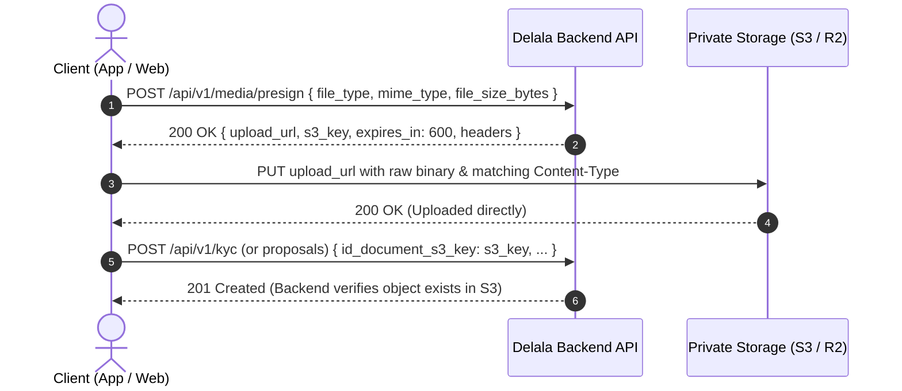

# Media Upload & KYC Module - Frontend Integration Guide

**Project:** Delala Platform (Escrow-Backed Broker Marketplace)  
**SRS Reference:** `srs_v2.md` (Enterprise Production Grade v4.0)  
**Modules:**  
- **Module 3:** Media Upload Architecture (Direct S3 Pre-Signed Pipeline §9.1)  
- **Module 4:** Delala Onboarding, KYC & Payout Profiles (§6.2 & §7 AR-1)  

---

## 1. Media Upload Pipeline (S3 / Cloudflare R2 Direct Upload)

To prevent PHP application server exhaustion, **file binaries never pass through the Laravel backend**. The frontend follows a 2-step direct upload flow:



---

### Step 1: Request Upload Slot
**`POST /api/v1/media/presign`** (Requires Bearer Token)

#### Request Payload:
```json
{
    "file_type": "kyc_id",            // "kyc_id" | "proposal_image" | "dispute_evidence"
    "mime_type": "image/jpeg",        // "image/jpeg" | "image/png" | "image/webp" | "application/pdf"
    "file_size_bytes": 2048000        // File size in bytes (Max 5,242,880 = 5MB)
}
```

*File Type Restrictions:*
* `proposal_image`: JPEG, PNG, WEBP only (max 5MB).
* `kyc_id`: JPEG, PNG, WEBP, or PDF (max 5MB).
* `dispute_evidence`: JPEG, PNG, WEBP, or PDF (max 5MB).

#### Response (200 OK):
```json
{
    "upload_url": "https://delala-kyc.r2.cloudflarestorage.com/kyc/2/e3f4g5.jpg?X-Amz-...",
    "s3_key": "kyc/2/e3f4g5.jpg",
    "expires_in": 600,
    "headers": {
        "Content-Type": "image/jpeg"
    }
}
```

### Step 2: Upload Binary Directly to Storage
Send an HTTP `PUT` request directly to the `upload_url` with the raw file payload:
```javascript
// Example using fetch:
await fetch(upload_url, {
    method: 'PUT',
    headers: {
        'Content-Type': 'image/jpeg'
    },
    body: fileBlob
});
```

### Step 3: Pass the `s3_key` to Backend Form
Once the `PUT` returns `200 OK`, use the returned `s3_key` when submitting your form to `/api/v1/kyc`, proposal items, or dispute evidence.

---

## 2. Delala KYC Submission & Status

### 2.1 Get Current KYC Status
**`GET /api/v1/kyc`** (Requires Delala Bearer Token)

#### Response (200 OK):
```json
{
    "status": "under_review", // "pending_submission" | "under_review" | "approved" | "rejected"
    "profile": {
        "id": 1,
        "user_id": 2,
        "document_type": "kebele_id",
        "status": "under_review",
        "rejection_reason": null,
        "created_at": "2026-10-22T16:00:00Z"
    },
    "urls": {
        "id_front_url": "https://s3.temporaryUrl...", // Valid for 15 minutes
        "id_back_url": "https://s3.temporaryUrl...",
        "selfie_url": "https://s3.temporaryUrl..."
    }
}
```

---

### 2.2 Submit KYC Documents
**`POST /api/v1/kyc`** (Requires Delala Bearer Token)

#### Request Payload:
```json
{
    "document_type": "kebele_id", // "kebele_id" | "national_id" | "passport" | "drivers_license"
    "id_document_s3_key": "kyc/2/id_front_uuid.jpg",
    "id_document_back_s3_key": "kyc/2/id_back_uuid.jpg", // Optional for passport, recommended for Kebele ID
    "selfie_s3_key": "kyc/2/selfie_uuid.jpg"
}
```

#### Response (201 Created):
```json
{
    "message": "KYC documents submitted successfully. Please wait for admin approval.",
    "profile": {
        "id": 1,
        "status": "under_review"
    }
}
```

#### Error Response (400 Bad Request):
Returned if the Delala already has an approved profile or one currently under review.

---

## 3. Payout Destinations (Bank & Telebirr Profiles)

Delalas must register at least one payout destination before requesting a withdrawal.

### 3.1 List Payout Destinations
**`GET /api/v1/payout-destinations`** (Requires Delala Bearer Token)

#### Response (200 OK):
```json
[
    {
        "id": 1,
        "bank_code": "CBE",
        "bank_name": "Commercial Bank of Ethiopia",
        "account_number": "1000123456789",
        "account_holder_name": "Abebe Kebede",
        "telebirr_number": null,
        "is_default": true,
        "verified_at": null
    },
    {
        "id": 2,
        "bank_code": "TELEBIRR",
        "bank_name": "Telebirr",
        "account_number": "0911223344",
        "account_holder_name": "Abebe Kebede",
        "telebirr_number": "0911223344",
        "is_default": false,
        "verified_at": null
    }
]
```

---

### 3.2 Register Payout Destination
**`POST /api/v1/payout-destinations`** (Requires Delala Bearer Token)

#### Request Payload:
```json
{
    "bank_code": "CBE",               // "CBE" | "AWASH" | "BOA" | "TELEBIRR" | etc.
    "bank_name": "Commercial Bank of Ethiopia",
    "account_number": "1000123456789",
    "account_holder_name": "Abebe Kebede", // Must match KYC legal name
    "telebirr_number": null,
    "is_default": true                 // First registered destination automatically becomes default
}
```

#### Response (201 Created):
```json
{
    "message": "Payout destination registered successfully.",
    "data": {
        "id": 1,
        "bank_code": "CBE",
        "is_default": true
    }
}
```

---

### 3.3 Set Default Destination
**`POST /api/v1/payout-destinations/{id}/set-default`** (Requires Delala Bearer Token)

#### Response (200 OK):
```json
{
    "message": "Default payout destination updated.",
    "data": {
        "id": 2,
        "is_default": true
    }
}
```

---

### 3.4 Delete Destination
**`DELETE /api/v1/payout-destinations/{id}`** (Requires Delala Bearer Token)

#### Response (200 OK):
```json
{
    "message": "Payout destination deleted successfully."
}
```

---

## 4. Admin KYC Verification Queue (AR-1)

Admin endpoints are protected by Sanctum and restricted to users with `role:admin`.

### 4.1 Get KYC Review Queue
**`GET /api/v1/admin/kyc?page=1`** (Admin Bearer Token)
Returns FIFO queue of `under_review` profiles with 15-minute temporary viewing URLs for front, back, and selfie.

### 4.2 Approve KYC Profile
**`POST /api/v1/admin/kyc/{id}/approve`** (Admin Bearer Token)
* Action: Transitions profile to `approved`, unlocks Delala capabilities (proposals, chat, discovery feed), and sends instant notification.

### 4.3 Reject KYC Profile
**`POST /api/v1/admin/kyc/{id}/reject`** (Admin Bearer Token)
#### Request Payload:
```json
{
    "reason": "The selfie photo does not clearly match the photo on your Kebele ID.",
    "rejection_code": "FACE_MISMATCH" // BLURRY_DOCUMENT | NAME_MISMATCH | FACE_MISMATCH | EXPIRED_DOCUMENT | SUSPECTED_FRAUD
}
```
* Action: Transitions profile to `rejected`, records admin note, and sends instant notification with the rejection reason.
