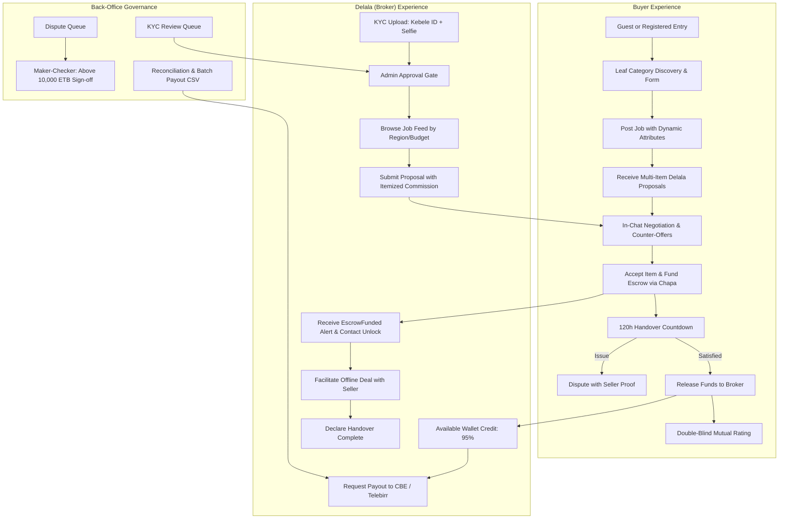

# Delala Bekise (ደላላ በኪሴ) — Frontend UI/UX Design Specification & Architecture

> **Brand Identity:** *Delala Bekise* ("Broker in your Pocket") transforms the traditional Ethiopian informal brokerage ecosystem into a modern, escrow-protected, transparent digital marketplace.

---

## 1. Design Philosophy & Ethos

1. **Uncompromising Trust & Escrow Transparency**:
   - The platform deals with high-stakes Ethiopian transactions (residential rentals, property purchases, vehicle sales).
   - Financial reassurance is paramount: Every commission deposit is clearly marked with its 100% escrow protection status, 95% broker payout, and 5% platform fee absorption.
   - Distinct, unmistakable visual badges for escrow states: `Pending Payment`, `Escrow Funded (Secure)`, `Handover Declared (120h Review Window)`, `Disputed`, `Released`.

2. **Mobile-First & Bandwidth Resilience**:
   - Over 75% of Ethiopian users browse on Ethio Telecom and Safaricom 4G/LTE mobile devices.
   - Low cognitive load, large tactile tap targets (min 44px), thumb-friendly bottom navigation sheets, and compact data transfer (direct S3 pre-signed uploads without proxying heavy binaries).
   - Graceful offline / spotty-connection cues and clear error tracking (`X-Request-ID` correlation logging).

3. **Bilingual & Culturally Grounded Typography**:
   - Harmonious pairing of modern Latin sans-serif (*Plus Jakarta Sans* or *Inter*) with Amharic typography (*Noto Sans Ethiopic*).
   - Familiar Ethiopian financial terminology: **ETB** (Birr), **Santim** (internal integer storage $\times 100$), **Telebirr**, and **CBE** (Commercial Bank of Ethiopia).

---

## 2. Color Palette & Visual System

| Token | Hex | Role & Psychology |
| :--- | :--- | :--- |
| **Primary (Escrow Emerald)** | `#0D7A57` / `#059669` | Represents safety, growth, financial escrow lock, and prosperity. Primary CTAs, active badges. |
| **Secondary (Abyssinian Slate / Navy)** | `#0F172A` / `#1E293B` | High authority, institutional reliability, top navigation, dark typography. |
| **Accent / Warning (Teff Gold & Amber)** | `#D97706` / `#F59E0B` | Countdown timers (120h handover window, 48h cancellation), urgent warnings, star ratings. |
| **Danger / Anti-Circumvention** | `#DC2626` / `#EF4444` | Anti-circumvention strike warnings, dispute triggers, cancellation rejections. |
| **Background (Clean Canvas)** | `#F8FAFC` / `#F1F5F9` | Crisp, modern contrast allowing cards and status chips to pop. |
| **Card Surface** | `#FFFFFF` | Subtle elevation (`box-shadow: 0 1px 3px rgba(0,0,0,0.08)`), rounded corners (`rounded-2xl`). |

---

## 3. Multi-Persona User Journeys & Interaction Architecture

---

## 4. Key Screens & UX Features Implemented in the Demo

1. **Role Switcher & Interactive Personas**:
   - Switch effortlessly between **Guest Buyer**, **Registered Buyer**, **Verified Delala**, and **Admin / Maker-Checker** to experience how the platform adapts its UI dynamically.
2. **Category & Dynamic JSON Schema Job Form**:
   - Switches form controls based on category (e.g. *Residential Rental* reveals bedrooms, generator, parking; *Passenger Cars* reveals make, model, year, transmission).
   - Live Santim to ETB auto-conversion.
3. **Multi-Item Proposal Cards**:
   - Delalas package up to 10 distinct physical assets/services with individual commission fees (minimum 100 ETB / 10,000 Santim floor).
4. **Anti-Circumvention Chat with Real-Time Strike Detection**:
   - Pre-contract contact redaction (`contact_details: null`).
   - Interactive simulation: typing phone numbers (`0911...`, `+251...`) or `@telegram` handles triggers immediate strike notification!
   - In-chat Delala commission price adjustment with history chip.
5. **Chapa Escrow Checkout Modal**:
   - Transparent calculation: 100% deposit, 95% Delala allocation, 5% platform service cut.
6. **Escrow Tracker & Handover Clock**:
   - Real-time animated 120-hour countdown banner.
   - Dual actions: Buyer release vs. dispute with proof of payment to third-party seller.
7. **Delala Wallet & Batch Payout Drawer**:
   - Live ledger balances (`delala_available_wallet` vs. `delala_pending_wallet`).
   - Withdrawal to CBE / Telebirr with 500 ETB minimum floor.
8. **Double-Blind Concealed Reviews**:
   - 14-day post-handover review submission with blind privacy indicator.
